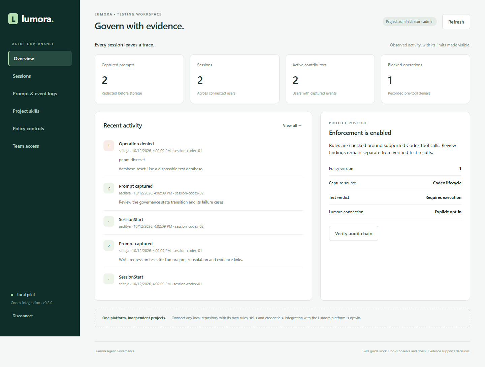

# Lumora Agent Governance

A separate Codex plugin and local management product for **prompt logs, user/session visibility, approved skill refresh, and the connected repository's own project rules**. **Lumora is the management platform. The target can be any local project, regardless of language or framework.** One installed plugin serves independent project connections.



The implementation includes an authenticated dashboard, project-scoped admin/observer/agent credentials, SQLite persistence, hash-chained audit records, prompt redaction, a persistent retry queue, versioned skill releases, six Codex lifecycle handlers, a static review command, a packaged plugin and an npm CLI distribution. It runs without a model API key.

This is a working **local pilot**, not a claim of production certification. Lumora remains unmodified and disconnected. Live Codex hook trust/discovery and a real Lumora integration are the remaining acceptance steps. [Implementation plan](docs/IMPLEMENTATION_PLAN.md) · [Validation and limitations](docs/VALIDATION.md) · [Integration contracts](docs/INTEGRATION.md).

## 1. Run the management console now

Requirements: Node **24 or newer**, npm, and PowerShell or another terminal. On Windows use `npm.cmd` if PowerShell execution policy blocks `npm.ps1`.

```powershell
cd D:\Downloads\plugin_based_agent
npm.cmd ci --ignore-scripts
npm.cmd run demo
node src/cli.ts serve --data .lumora-agent/demo
```

Open **http://127.0.0.1:4318**. Get the demo administrator credential from `.lumora-agent/demo/credentials.json` and enter it in the login form. This file is generated locally and ignored by Git. The prepared demo already exists in this checkout, so you can go straight to the `serve` command; `demo` intentionally refuses to overwrite an existing project.

Demo prompts/denials are labelled synthetic in the CLI and come from fixtures, not your ChatGPT history or a live Lumora instance. The service binds only to loopback. Stop it with Ctrl+C. The dashboard stores its credential only in tab memory and signs out on page refresh.

Views: overview; sessions; searchable/filterable prompt and event logs; approved skill release; policy settings; user credential issuance/revocation. Agents see only their own activity. Observers see project activity. Administrators also manage access, policies and skill releases. Export downloads the currently loaded filtered events, not every historical event.

## 2. Create a real pilot project

Use a separate service data directory from the demonstration:

```powershell
node src/cli.ts init --project my-project --name "My project" --user manager
node src/cli.ts serve
```

`init` prints the administrator token once and seeds the three packaged skills. Save that credential securely. The service stores only its SHA-256 digest. With the administrator token, issue a separate `agent` credential for each developer through Team access. Never share one developer token among multiple people: that collapses attribution into one user.

To use the CLI, set the appropriate credential in the terminal that will launch Codex. Do not commit it:

```powershell
$env:LUMORA_AGENT_TOKEN = "<your project credential>"
node src/cli.ts connect --root "<pilot repository path>" --project my-project
```

The command authenticates to the control plane and writes `.lumora-agent/connection.json` in that repository. It stores only URL/project/environment-variable references, never the credential. Add `.lumora-agent/` to that repository's local ignore rules before working there. Do this in a pilot checkout first; connecting the real `D:\Downloads\coznt_angular` is intentionally deferred.

## 3. Install the Codex plugin

The ready-built package is **`dist/lumora-governance-0.2.0`**. It includes root `plugin.json`, a compatibility manifest, three skills, `hooks/hooks.json`, compiled JavaScript and its pinned Zod runtime dependency. It does not download npm packages on every prompt.

Use the local marketplace commands in [Install once, connect each repository](docs/INSTALL_ONCE.md). Set `LUMORA_AGENT_TOKEN` in the environment inherited by Codex and connect the intended repository as above. Restart Codex if necessary, open `/hooks`, and review/trust the hook definitions. The product never bypasses native trust.

For a project-local pilot, the CLI can instead install equivalent hook registrations:

```powershell
node src/cli.ts install --root "<pilot repository path>" --package "D:\Downloads\plugin_based_agent\dist\lumora-governance-0.2.0"
```

**Choose one installation route.** Enabling both the packaged plugin hooks and project-local hooks will double-capture events. Existing Lumora prompt hooks also need an explicit ownership decision before a live rollout; the installer warns and preserves them. The installer preserves foreign hook groups and backs up the original JSON. It refuses invalid existing configuration and linked paths.

The project-local route references the supplied runtime directory. Keep that versioned directory in place. To remove only this product's registrations:

```powershell
node src/cli.ts uninstall --root "<pilot repository path>"
```

Uninstall preserves other hooks, connection metadata, evidence and installed skills. Removing a plugin through Codex uses Codex's own plugin UI. Hook code or definitions changing may require renewed trust.

For a new distribution build, use a **new output directory**:

```powershell
node src/cli.ts package --out dist/lumora-governance-next
```

The public ChatGPT plugin directory is not the distribution target for this hook-based local package. See [OpenAI's packaging documentation](https://developers.openai.com/plugins/build/plugins) for current local installation and hook distribution limits.

## 4. Daily operation and recovery

```powershell
node src/cli.ts doctor --root "<pilot repository path>"
node src/cli.ts status --root "<pilot repository path>"
node src/cli.ts flush --root "<pilot repository path>"
node src/cli.ts sync --root "<pilot repository path>"
```

- **SessionStart** downloads the latest policy and approved skills. Hash validation precedes writes. Modified/unmanaged skills are retained and a warning is reported. Disk refresh does not prove the active model reloaded skill discovery; check in a new session.
- **UserPromptSubmit** redacts likely credentials, queues the prompt locally, and attempts delivery. Network failure leaves it queued. Retry retains the same event ID. Events are bound to server/project/credential identity; another credential cannot flush them.
- **PreToolUse** checks recognized DB resets and optionally DB push commands, explicit patch/edit paths, governance/secret-file edits and configured source-rule candidates. Enforce mode returns a native denial for error findings; observe mode records them. Shell text matching is not an interpreter or security sandbox.
- **PostToolUse** records the tool observation. Explicit exit codes can establish command success/failure; unknown tool output remains `unknown`. It never becomes test success automatically.
- **Stop** asks for accurate verification reporting once per turn; it honors `stop_hook_active`. This is a reporting reminder, not proof that tests ran.
- **SessionEnd** records an end event if the host supplies it. Abrupt termination may leave a session with no end event. Stop is not session end.

The queue is bounded by 10,000 events or roughly 32 MB of payload characters. Flush handles up to 200 queued events per command with a 30-second budget; repeat for a larger backlog. HTTP failures remain queued with exponential retry delay. Switching/revoking a credential does not silently reassign old events. Recover with the original valid credential or define an administrator-reviewed migration; automatic reattribution is intentionally absent.

If a sync lock remains after a process crash, first verify no sync is running. Inspect `.lumora-agent/skill-sync.lock` and the receipt, then remove only the stale lock. Ordinary I/O failures roll back writes; a process crash between file writes is not a filesystem-wide transaction and may require restoration from the approved release. Do not overwrite locally modified skills to hide a conflict.

## 5. Project-aware skills and review

| Skill | Purpose |
|---|---|
| `project-review` | Review defects against this repository's documented architecture and requirements |
| `project-testing` | Write and run tests using this repository's own framework and conventions |
| `project-governance` | Diagnose capture/sync/denials and work within the connected project's rules |

Administrators publish immutable releases using a connected administrator credential:

```powershell
node src/cli.ts publish --root "<pilot repository path>" --skills skills --version 2.0.0
```

Republishing different content under the same release version is rejected. Re-publishing the exact older release activates a rollback. Each session refreshes from the active catalog. Local skill directories are namespaced under `.agents/skills/project-*` (legacy `lumora-*` releases remain readable) and only unchanged, receipt-owned stale files are removed.

Read-only static review:

```powershell
node src/cli.ts profile --root "<repository path>"
node src/cli.ts review --root "<repository path>" --out .lumora-agent/reports/project-review.json
```

This scans tracked/unignored source files for configured project source rules and recognized destructive Playwright setup. There are no default Lumora architecture rules. See [project rules and scope](docs/PROJECT_RULES.md). It does not execute project code, reset databases, generate tests or claim a runtime verdict. The included testing skill guides Codex in writing and running meaningful tests. An autonomous test-generation/execution service like Ardberg is a separate future integration.

## 6. npm / npx distribution

```powershell
npm.cmd run build
npm.cmd pack --pack-destination dist
```

The tarball contains compiled JavaScript; Node's restriction on stripping TypeScript inside `node_modules` is avoided. After installing the local tarball in an isolated tooling directory, run `npx.cmd --no-install lumora-agent help`. The package remains private and has not been published to npm. Pin a reviewed package version when distributing internally; do not use `npx latest` in lifecycle hooks.

## 7. Validation

```powershell
npm.cmd run verify
npm.cmd run test:ui
```

`verify` performs strict TypeScript checks and Node integration tests. Browser tests use installed Edge on Windows; set `PLAYWRIGHT_CHANNEL` to a supported installed browser on other systems, or install Playwright Chromium. They use an ephemeral local database and synthetic events. Tests do not call an LLM, a live Lumora service or GitHub.

## 8. Data and deployment boundaries

Service data: `.lumora-agent/service/control.sqlite` plus WAL/SHM. Per-repository data: connection JSON, outbox SQLite, skill receipt and hook backup. Keep the service directory accessible only to its operator. Stop the service before a file-based backup and preserve the database consistently with its WAL; use SQLite-aware backup tooling for online backups. Backup restoration must be verified in a separate directory. There is no automatic retention purge; define retention and encryption-at-rest requirements before shared use.

Prompt redaction is heuristic, not a guarantee that no secret or PII remains. The audit chain detects stored audit-row changes relative to its chain; without an external trusted checkpoint it cannot prove absence of truncation/full-chain replacement. The local filesystem owner can alter hooks and database files. Use managed host policy and Lumora server-side authorization for stronger enforcement.

Before Angular/Next.js integration: map actual Lumora users/projects, add the service behind authenticated same-origin operations, adopt Lumora's existing Drizzle/Postgres/CRUD/evidence primitives, add TLS/SSO, retention, backups and operational monitoring. Do not expose this loopback pilot directly to the internet or treat its local tokens as the final SSO design.
